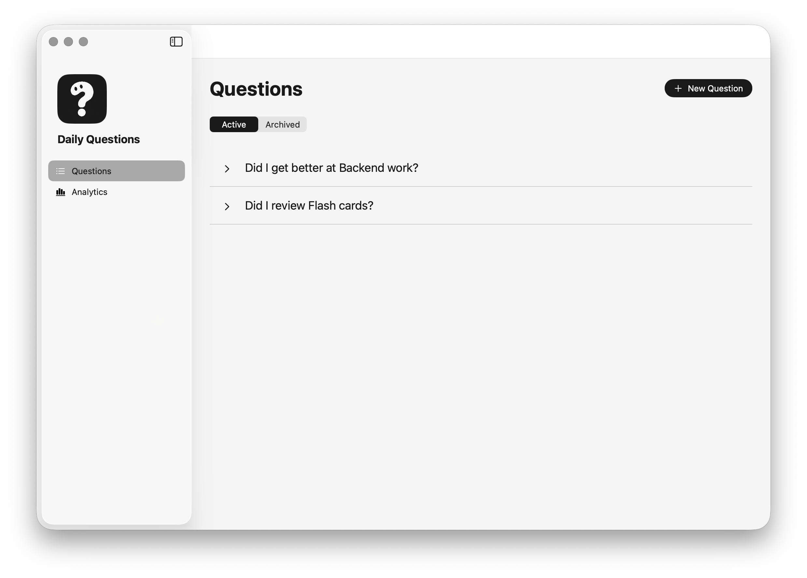
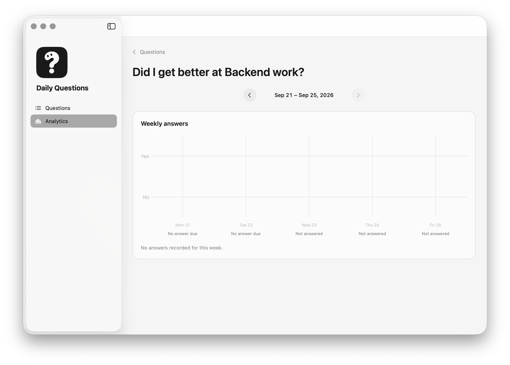

# Daily Questions

Daily Questions is a native macOS app in Swift and SwiftUI, with local SQLite storage. An iPhone app in the same project shares the model and syncs through a folder in iCloud Drive.

## Demo

A walkthrough of the menu bar panel and desktop window. The source file is also in the repository at [videos/daily-questions-launch-web.mp4](videos/daily-questions-launch-web.mp4).

https://github.com/user-attachments/assets/98bb158c-a82c-40e3-80bd-5dbb70b09365

## Screenshots

These screenshots show the Questions and weekly report views in the macOS app.





Use the menu bar panel to answer today's questions with Yes or No. Open the desktop window with the app icon at the top right of the panel to create, view, edit, and archive questions, or select a question to see four weeks of Yes activity and inspect one Monday–Friday week of answers at a time. The app shows in the Dock only while the desktop window is open. Press Command-Q while the panel or window is focused to quit.

The schedule is fixed to Monday through Friday. There is no day selection, desktop Today screen, or streak tracking. Saved answers cannot be changed. Questions are never deleted: archiving stops daily prompts and keeps history. Editing question wording updates its label in all reports without changing answers.

The [project transcript](transcript.md) describes the original MVP. The [design references](designs/README.md) use a Mononote-inspired neutral palette and minimal, factual copy without motivational text; the desktop uses a Liquid Glass sidebar with opaque main content. The [four-week activity spec](specs/FOUR_WEEK_ACTIVITY.md) includes the newer Analytics mock-ups. The [tech stack document](specs/TECH_STACK.md) records the implementation choices, including the confirmed SwiftData connection to SQLite.

Daily Questions MVP specifications:

- [Menu bar answers](specs/MENU_BAR.md)
- [Desktop question management](specs/QUESTION_MANAGEMENT.md)
- [Desktop question performance](specs/QUESTION_PERFORMANCE.md)
- [Four-week activity overview](specs/FOUR_WEEK_ACTIVITY.md)
- [Analytics overview](specs/ANALYTICS_OVERVIEW.md)

## Xcode project

Open `DailyQuestions.xcodeproj` in Xcode, select the `DailyQuestions` scheme and **My Mac**, then press **Run**.

The project contains the macOS app, the menu bar panel, question management, a four-week activity overview, weekly reports, and a shared SwiftData store backed by local SQLite. It uses Swift 6 language mode, a macOS 26.0 deployment target, and **Sign to Run Locally** signing without a developer team.

Verified with Xcode 26.3 (17C529), Swift 6.2.4, and macOS 26.6.2.

To build from the repository directory:

```sh
xcodebuild -project DailyQuestions.xcodeproj -scheme DailyQuestions \
  -configuration Debug -destination 'platform=macOS,arch=arm64' \
  -derivedDataPath /tmp/daily-questions-derived build
```

## iPhone app

The `DailyQuestionsiOS` target builds the same app for iPhone with an iOS 26.0 deployment target. It has three tabs: Today replaces the menu bar panel, Questions keeps the single list with an editor inside the selected row, and Analytics opens one question's four-week overview and week in detail. Settings, from the gear on Today, holds the sync folder and an optional weekday reminder that uses a local notification.

The iPhone sources live in `DailyQuestionsiOS`. `Models.swift`, `Sync.swift`, `Palette.swift`, `AnswerControls.swift`, `SyncSettings.swift`, and `PerformanceView.swift` are shared with the Mac target.

To run it on your own iPhone without a paid developer membership:

1. In Xcode, add your Apple ID under Settings › Accounts. Xcode creates a free Personal Team.
2. Select the `DailyQuestionsiOS` scheme, open the target's Signing & Capabilities tab, and pick that team.
3. Turn on Developer Mode on the phone under Settings › Privacy & Security, connect it, and press **Run**.
4. After the first install, trust the certificate on the phone under Settings › General › VPN & Device Management.

A free team signs the app for 7 days. Re-run from Xcode to renew it; the app's data stays. The simulator needs no signing:

```sh
xcodebuild -project DailyQuestions.xcodeproj -target DailyQuestionsiOS \
  -configuration Debug -sdk iphonesimulator -arch arm64 \
  CODE_SIGNING_ALLOWED=NO build
```

## Sync

Both apps can share one folder, normally in iCloud Drive. Each device writes its own JSON file there, named by a device ID, and reads the others' files on launch, when the app becomes active, after every save, and when Sync now is pressed. The local SQLite store stays the source of truth; the folder is only the courier. The folder is chosen through the system file picker, so neither app needs a paid iCloud or CloudKit entitlement.

Merging never changes a saved answer: answers are a union keyed by question and day. A question's wording takes the newer edit, and archiving is one way, keeping the earlier archive day. Set it up on the Mac under Settings in the sidebar and on the iPhone under Settings from the Today gear, choosing the same folder on both.

## Verification

Run the model and date checks on this Mac:

```sh
scripts/check-store.sh
scripts/check-report.sh
scripts/check-analytics.sh
scripts/check-sync.sh
```

The checks use temporary stores and do not modify app data. They cover persistence, immutable answers, archive history, failed-save rollback and retry, weekday rules, DST, midnight, time-zone changes, and the sync merge and folder exchange.

For isolated UI testing, the `DailyQuestions-Verification` scheme passes `--verification` and uses a separate store. The standard scheme uses the real app store. A verification build with the `VERIFICATION` Swift condition also exposes the same menu panel in a normal window; this window is absent from normal builds.

See the [verification record](specs/VERIFICATION.md) for completed checks and limits.
