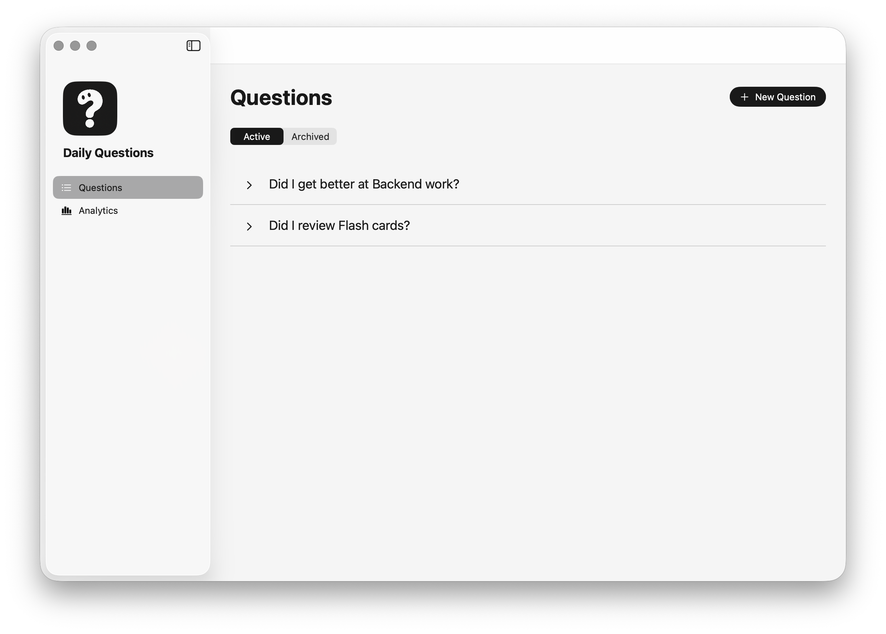
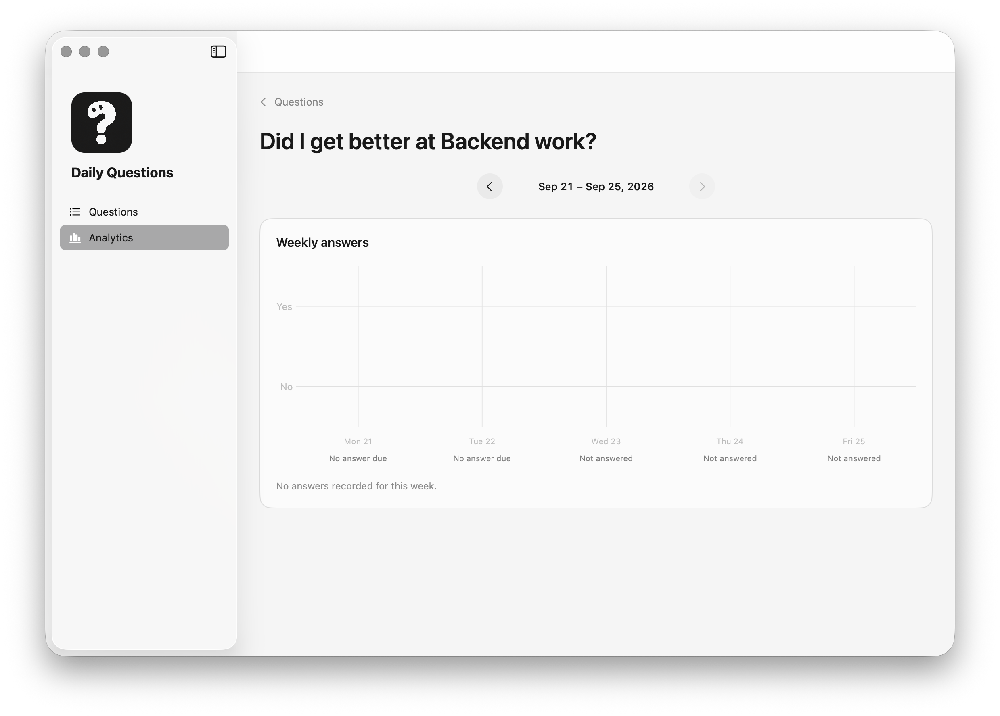

# Daily Questions

Daily Questions is a native macOS app in Swift and SwiftUI, with local SQLite storage.

## Screenshots

These screenshots show the Questions and weekly report views in the macOS app.





Use the menu bar panel to answer today's questions with Yes or No. Open the desktop window from the Dock to create, view, edit, and archive questions, or select a question to see four weeks of Yes activity and inspect one Monday–Friday week of answers at a time.

The schedule is fixed to Monday through Friday. There is no day selection, desktop Today screen, or streak tracking. Saved answers cannot be changed. Questions are never deleted: archiving stops daily prompts and keeps history. Editing question wording updates its label in all reports without changing answers.

The [project transcript](transcript.md) describes the original MVP. The [design references](designs/README.md) use a Mononote-inspired neutral palette and minimal, factual copy without motivational text; the desktop uses a Liquid Glass sidebar with opaque main content. The [four-week activity spec](specs/FOUR_WEEK_ACTIVITY.md) includes the newer Analytics mock-ups. The [tech stack document](specs/TECH_STACK.md) records the implementation choices, including the confirmed SwiftData connection to SQLite.

Daily Questions MVP specifications:

- [Menu bar answers](specs/MENU_BAR.md)
- [Desktop question management](specs/QUESTION_MANAGEMENT.md)
- [Desktop question performance](specs/QUESTION_PERFORMANCE.md)
- [Four-week activity overview](specs/FOUR_WEEK_ACTIVITY.md)
- [Analytics overview](specs/ANALYTICS_OVERVIEW.md)

## Xcode project

Open `DailyQuestions.xcodeproj` in Xcode, select the `DailyQuestions` scheme and **My Mac**, then press **Run**.

The project contains the macOS app, the menu bar panel, question management, a four-week activity overview, weekly reports, and a shared SwiftData store backed by local SQLite. It uses Swift 6 language mode, a macOS 26.0 deployment target, and **Sign to Run Locally** signing without a developer team.

Verified with Xcode 26.3 (17C529), Swift 6.2.4, and macOS 26.6.2.

To build from the repository directory:

```sh
xcodebuild -project DailyQuestions.xcodeproj -scheme DailyQuestions \
  -configuration Debug -destination 'platform=macOS,arch=arm64' \
  -derivedDataPath /tmp/daily-questions-derived build
```

## Verification

Run the model and date checks on this Mac:

```sh
scripts/check-store.sh
scripts/check-report.sh
scripts/check-analytics.sh
```

The checks use temporary stores and do not modify app data. They cover persistence, immutable answers, archive history, failed-save rollback and retry, weekday rules, DST, midnight, and time-zone changes.

For isolated UI testing, the `DailyQuestions-Verification` scheme passes `--verification` and uses a separate store. The standard scheme uses the real app store. A verification build with the `VERIFICATION` Swift condition also exposes the same menu panel in a normal window; this window is absent from normal builds.

See the [verification record](specs/VERIFICATION.md) for completed checks and limits.
