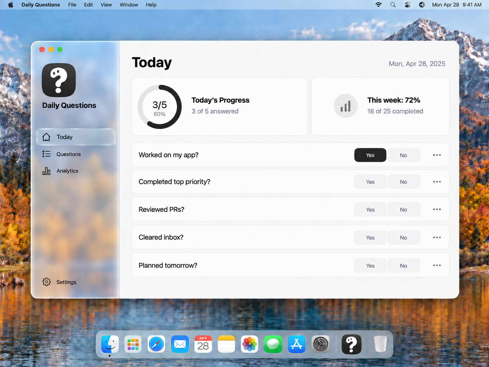
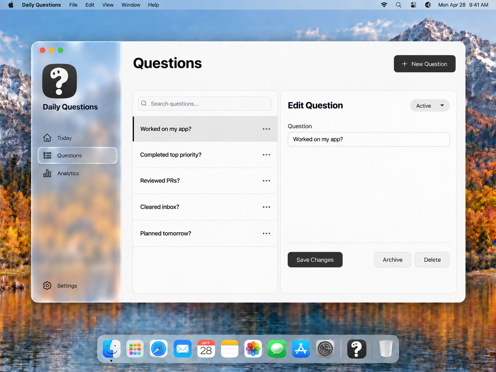
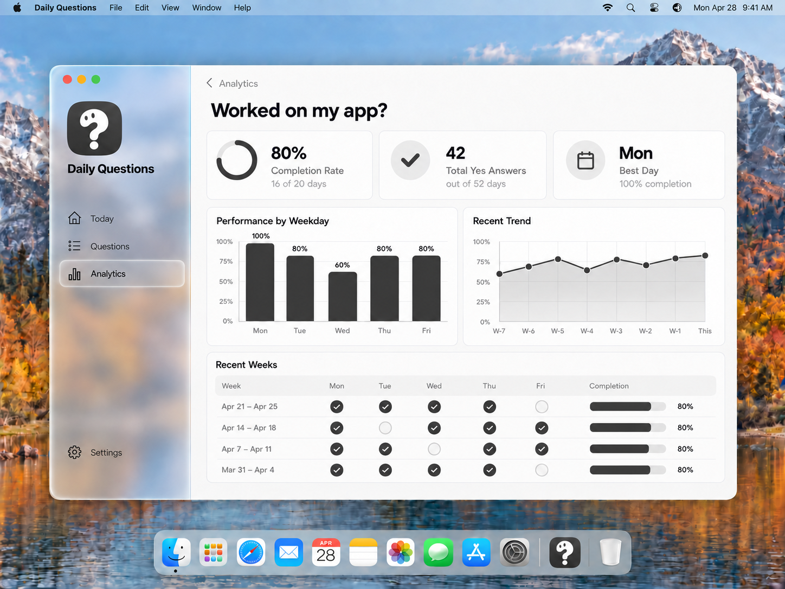

# Liquid Glass sidebar previews

Historical source only. Superseded by the [current MVP designs](README.md). Any Today screen, Delete control, editable saved answer, or multiweek summary shown here is outside the current MVP.

Generated with built-in imagegen. These are visual concept previews, not native macOS runtime screenshots. The sidebar transmits blurred wallpaper colors; the main content stays opaque and neutral. The approved character logo is retained.

## Previews

## Exact edit prompts

### questions

Input: `questions-logo.png`

Output: `questions-liquid-glass.png`

Use case: precise-object-edit. The supplied image is the EDIT TARGET: the questions screen of the Daily Questions macOS app. Create a design preview changing ONLY the LEFT SIDEBAR MATERIAL to an elegant Apple Liquid Glass inspired appearance. Keep the sidebar's current width, bounds and geometry within the existing window. Replace its opaque off-white background with a visibly translucent frosted glass material: softly blurred desktop wallpaper visible through the pane, muted sky-blue and warm amber colors transmitted from the mountain landscape behind it, subtle glass refraction along the edges, a thin luminous edge and restrained specular highlights. The result should clearly read as glass, not merely gray opacity or a flat gradient. Use enough milky diffusion to keep the sidebar's dark labels and icons crisp and easy to read. Give the existing selected navigation row a subtle translucent rounded glass highlight with a delicate rim. Retain exactly the current selected item. Preserve the approved charcoal square question-mark creature logo, its white character and two dark eyes, and all sidebar text, icons, positions, traffic-light controls and Settings control. Keep the entire main content panel to the RIGHT opaque neutral off-white, with ALL its original content, metrics, questions, charts, controls, typography, spacing and states unchanged. Preserve the entire outer wallpaper, macOS menu bar, Dock including the character logo, framing and aspect ratio. Do not enlarge, move or float the sidebar, redesign the layout, add controls or decorations, apply glass to the main content, or change any copy. One complete edited screenshot at the source aspect ratio.

### performance

Input: `performance-logo.png`

Output: `performance-liquid-glass.png`

Use case: precise-object-edit. The supplied image is the EDIT TARGET: the performance screen of the Daily Questions macOS app. Create a design preview changing ONLY the LEFT SIDEBAR MATERIAL to an elegant Apple Liquid Glass inspired appearance. Keep the sidebar's current width, bounds and geometry within the existing window. Replace its opaque off-white background with a visibly translucent frosted glass material: softly blurred desktop wallpaper visible through the pane, muted sky-blue and warm amber colors transmitted from the mountain landscape behind it, subtle glass refraction along the edges, a thin luminous edge and restrained specular highlights. The result should clearly read as glass, not merely gray opacity or a flat gradient. Use enough milky diffusion to keep the sidebar's dark labels and icons crisp and easy to read. Give the existing selected navigation row a subtle translucent rounded glass highlight with a delicate rim. Retain exactly the current selected item. Preserve the approved charcoal square question-mark creature logo, its white character and two dark eyes, and all sidebar text, icons, positions, traffic-light controls and Settings control. Keep the entire main content panel to the RIGHT opaque neutral off-white, with ALL its original content, metrics, questions, charts, controls, typography, spacing and states unchanged. Preserve the entire outer wallpaper, macOS menu bar, Dock including the character logo, framing and aspect ratio. Do not enlarge, move or float the sidebar, redesign the layout, add controls or decorations, apply glass to the main content, or change any copy. One complete edited screenshot at the source aspect ratio.

### today

Input: `today-logo.png`

Output: `today-liquid-glass.png`

Use case: precise-object-edit. The supplied image is the EDIT TARGET: the today screen of the Daily Questions macOS app. Create a design preview changing ONLY the LEFT SIDEBAR MATERIAL to an elegant Apple Liquid Glass inspired appearance. Keep the sidebar's current width, bounds and geometry within the existing window. Replace its opaque off-white background with a visibly translucent frosted glass material: softly blurred desktop wallpaper visible through the pane, muted sky-blue and warm amber colors transmitted from the mountain landscape behind it, subtle glass refraction along the edges, a thin luminous edge and restrained specular highlights. The result should clearly read as glass, not merely gray opacity or a flat gradient. Use enough milky diffusion to keep the sidebar's dark labels and icons crisp and easy to read. Give the existing selected navigation row a subtle translucent rounded glass highlight with a delicate rim. Retain exactly the current selected item. Preserve the approved charcoal square question-mark creature logo, its white character and two dark eyes, and all sidebar text, icons, positions, traffic-light controls and Settings control. Keep the entire main content panel to the RIGHT opaque neutral off-white, with ALL its original content, metrics, questions, charts, controls, typography, spacing and states unchanged. Preserve the entire outer wallpaper, macOS menu bar, Dock including the character logo, framing and aspect ratio. Do not enlarge, move or float the sidebar, redesign the layout, add controls or decorations, apply glass to the main content, or change any copy. One complete edited screenshot at the source aspect ratio.
