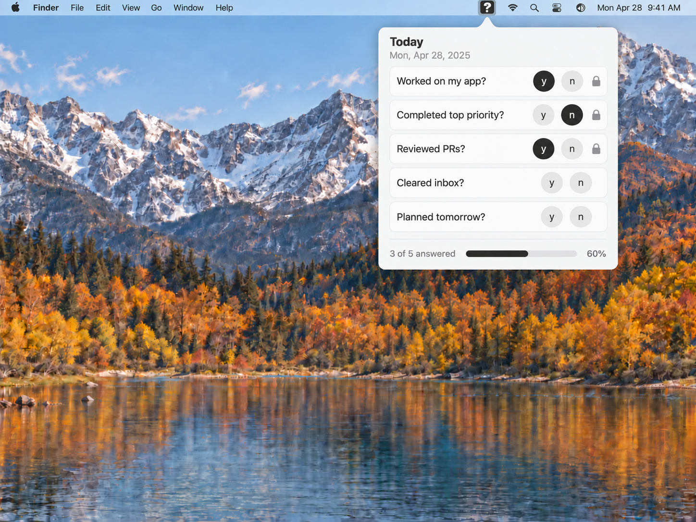
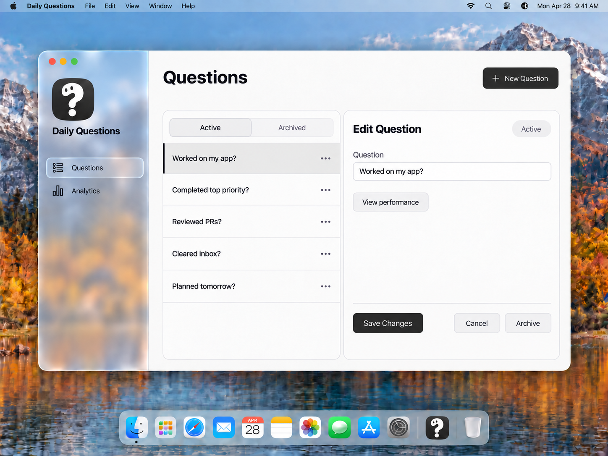
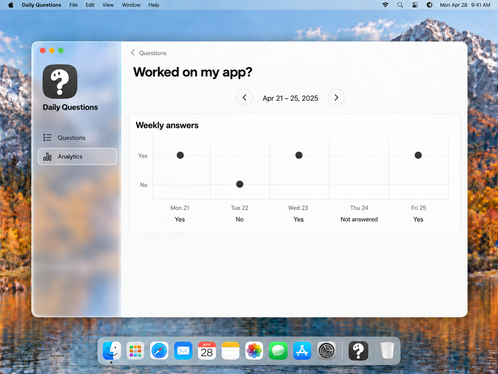

# Current MVP designs

Use these three images for implementation. They revise the most recent character-logo and Liquid Glass designs to match the confirmed MVP. Earlier images and prompt files are historical sources, not implementation references.

- Show one Monday–Friday week at a time in performance reports.
- No desktop Today screen. Answer questions in the menu bar only.
- Archive questions and retain their history. Never delete them.
- Editing question wording updates labels in all reports without changing saved answers.
- Saved answers are read-only, including today's answers.
- Use a Liquid Glass desktop sidebar and opaque neutral main content.

Keep copy short and factual. No motivational text or streaks. Red is for app errors only, with explanatory text. Archive, No, missing answers, and saved states use neutral styling. Native macOS window controls retain system colors.

These are concept images edited with built-in imagegen, not native runtime screenshots. The [exact revision prompts](MVP_REFINEMENT_PROMPTS.md) are saved. The feature specs define behavior, including states not pictured here.

## Logo

Use the approved [question-mark character](daily-questions-logo-concept.png): an off-white character with two dark eyes and a separate dot on charcoal. Use it in the sidebar, Dock, and menu bar status icon. The menu panel has no branding header.

## Palette

Use the neutral light palette shown in the [Mononote app preview](https://www.digitalminimalist.com/tools/mononote): off-white surfaces, dark text, gray borders, and near-black primary buttons. The following values are project approximations based on the preview, not official Mononote design tokens or sampled exact values. Generated mockups illustrate the palette; use these values when implementing it.

| Role | Color | Use |
| --- | --- | --- |
| App background | `#F5F5F5` | Opaque main content and menu bar panel; sidebar uses Liquid Glass. |
| Surface | `#FAFAFA` | Cards and fields. |
| Primary text and accent | `#1A1A1A` | Headings, body text, primary buttons, selected answers, chart marks, and app icon background. |
| Text on accent | `#FFFFFF` | Labels and glyphs on charcoal fills. |
| Secondary text | `#666666` | Supporting labels and inactive icons. |
| Border and track | `#DEDEDE` | Dividers, subtle borders, and progress tracks. |
| Selection background | `#E5E5E5` | Neutral badges; sidebar selection uses a translucent glass highlight. |
| Error | System red | App errors only, with explanatory text. |

Use this palette throughout app-owned controls, charts, badges, and the app icon. Do not use blue or green as app accents. Selected Yes and No controls use the same charcoal treatment; labels identify the answer. Use Liquid Glass in the desktop sidebar, allowing blurred wallpaper colors through while keeping labels readable. Main content remains opaque and neutral. Respect system accessibility preferences for reduced transparency. The wallpaper, other apps' Dock icons, and native macOS window controls retain their system colors.

## Menu bar

Start with Today and the date. No branding or settings header. Use small circular `y` and `n` controls with accessible names Yes and No. After saving, both controls are disabled, with a lock and an accessible saved-state label. A failed save leaves the question available to retry.

This example has two Yes answers, one No, and two unanswered questions: 3 of 5 answered, or 60%. That is answer completion, not Yes rate.

## Questions

Use Questions and Analytics navigation. Active and Archived lists keep archived question history accessible. Save Changes updates wording; Cancel discards the edit; Archive stops future prompts and preserves data. No Delete control. View performance opens the selected question's report. Archived records are viewable; restore is outside the MVP.

## Performance

Show one week with previous/next week controls and a date range. Default to the current week and disable next at that week. Use Yes/No marks and a separate missing-answer label. No editable answers, multiweek trends, scores, or ranking cards. Use current question wording for active and archived questions.

## Historical references

The [earlier glass previews](LIQUID_GLASS_PREVIEWS.md), [logo edits](LOGO_APPLICATION_PROMPTS.md), [palette edits](MONOCHROME_PROMPTS.md), and [initial edits](PROMPTS.md) are retained as design history. Their Today screens, Delete controls, and aggregate charts are superseded. Only the three images above are current implementation references.
