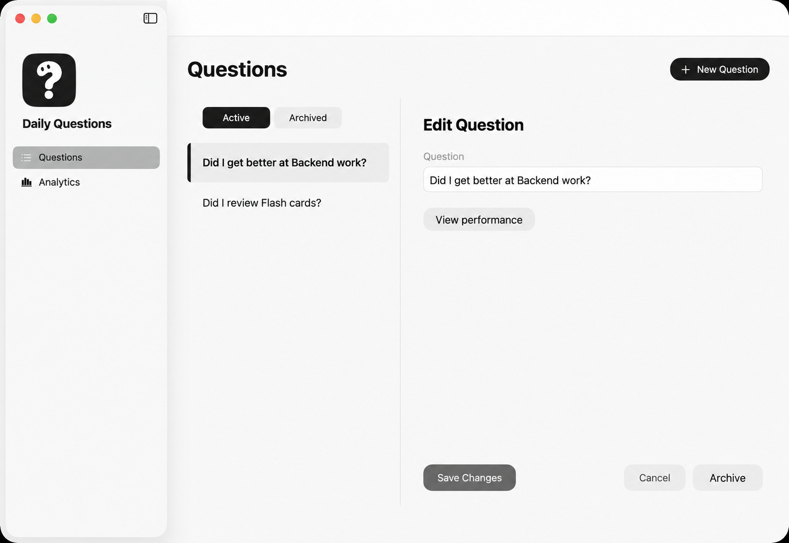
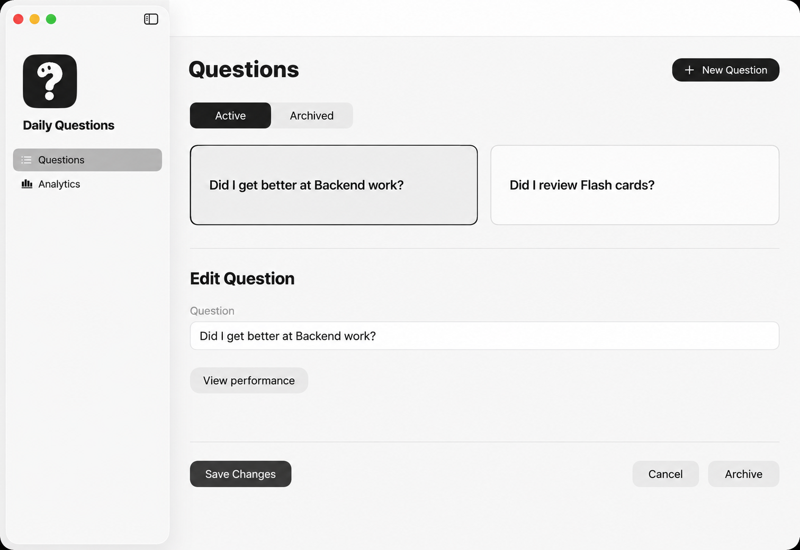
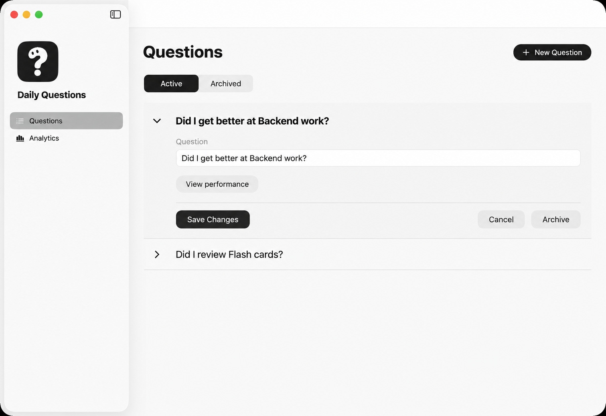

# Question selection concepts

September 26, 2026. Generated with built-in imagegen from the user-supplied Daily Questions screenshot. Option 3 was selected for implementation. Options 1 and 2 remain historical alternatives. Option numbers match the order displayed in the conversation.

## Option 1: Compact selection rail

## Option 2: Question cards

## Option 3: Expand in place

## Exact prompts

### Compact selection rail

Create a realistic, production-quality native macOS UI design with clear hierarchy, strong typography and purposeful spacing. Use the user's attached Daily Questions screenshot as the visual source. This is a question-selection redesign, not a brand redesign.
Target dimensions: 2254 x 1552, same aspect ratio as the supplied window screenshot. Show one complete native application window, not a device or presentation board. Preserve the current left application sidebar, question-mark character logo, Daily Questions name, Questions and Analytics navigation, and neutral off-white/charcoal appearance. Keep the source's restrained sidebar material; do not extend Liquid Glass to buttons or content. SF-style typography, readable labels, understated dividers, minimal borders, no decorative shadows, no blue/green accents.
Goal: make the two-question selection experience feel intentional and lighter than the source's tall boxed column. Keep these exact records: "Did I get better at Backend work?" and "Did I review Flash cards?". The first record is selected. Preserve the Active and Archived states, New Question action, editable Question field, View performance, Save Changes, Cancel and Archive actions. No Delete, restore, reorder, tags, search, completion metrics, schedules or new product features. Do not add fictional questions. Current date anchor September 26, 2026; no dates are needed in this screen.
Use whitespace, alignment and typography first; separators second; surface tint third; borders sparingly. Keep body type readable and all content comfortably within the window. Do not wrap the whole design in an extra card. Output exactly one concept image, no annotations or concept labels.
Direction name: Compact selection rail. Retain the two-column question list + editor workflow but replace the tall bordered question-list card with a slim, borderless navigation rail on the main off-white surface, separated from the editor by one hairline vertical rule. Put compact Active/Archived tabs above two moderately compact rows with multiline question titles and generous horizontal padding. Selected row has a small dark vertical accent at the left, a subtle gray tint, stronger title weight, and NO chevron. Unselected row is plain. No giant empty enclosing list rectangle. The editor remains to the right, organized with a concise heading, field and nearby actions instead of footer actions far below. New Question stays top right. This concept optimizes quick scanning as the list grows, with minimal containers and no question cards. Keep left app sidebar unchanged.

### Question cards

Create a realistic, production-quality native macOS UI design with clear hierarchy, strong typography and purposeful spacing. Use the user's attached Daily Questions screenshot as the visual source. This is a question-selection redesign, not a brand redesign.
Target dimensions: 2254 x 1552, same aspect ratio as the supplied window screenshot. Show one complete native application window, not a device or presentation board. Preserve the current left application sidebar, question-mark character logo, Daily Questions name, Questions and Analytics navigation, and neutral off-white/charcoal appearance. Keep the source's restrained sidebar material; do not extend Liquid Glass to buttons or content. SF-style typography, readable labels, understated dividers, minimal borders, no decorative shadows, no blue/green accents.
Goal: make the two-question selection experience feel intentional and lighter than the source's tall boxed column. Keep these exact records: "Did I get better at Backend work?" and "Did I review Flash cards?". The first record is selected. Preserve the Active and Archived states, New Question action, editable Question field, View performance, Save Changes, Cancel and Archive actions. No Delete, restore, reorder, tags, search, completion metrics, schedules or new product features. Do not add fictional questions. Current date anchor September 26, 2026; no dates are needed in this screen.
Use whitespace, alignment and typography first; separators second; surface tint third; borders sparingly. Keep body type readable and all content comfortably within the window. Do not wrap the whole design in an extra card. Output exactly one concept image, no annotations or concept labels.
Direction name: Question cards with a focused inspector. Of the attached images, use the USER'S ORIGINAL SCREENSHOT as the product reference; the previously generated compact rail is a different concept and must not determine this layout. Create a meaningfully different selection layout: in the main content area below Questions and Active/Archived tabs, show exactly TWO separate question cards next to each other in a two-column grid. These are standalone question objects, so each has one subtle border and comfortable padding; no enclosing card around the grid. Each displays just its full question title. First card is selected using a dark charcoal outline and subtle gray fill, second plain off-white with a thin gray outline. No checkboxes or circles that suggest marking answers, no metrics, dates, tags or extra copy. Below this two-card strip, show the selected question editor directly on the main surface, with the Question field spanning a comfortable reading width and View performance, Save Changes, Cancel, Archive directly below. Remove the old narrow middle list column and the tall editor card. Preserve all existing capabilities and exact question titles. The question cards should feel tactile and inviting but minimal, no gloss, liquid glass, chunky shadows or decoration. Left app sidebar unchanged.

### Expand in place

Create a realistic, production-quality native macOS UI design with clear hierarchy, strong typography and purposeful spacing. Use the user's attached Daily Questions screenshot as the visual source. This is a question-selection redesign, not a brand redesign.
Target dimensions: 2254 x 1552, same aspect ratio as the supplied window screenshot. Show one complete native application window, not a device or presentation board. Preserve the current left application sidebar, question-mark character logo, Daily Questions name, Questions and Analytics navigation, and neutral off-white/charcoal appearance. Keep the source's restrained sidebar material; do not extend Liquid Glass to buttons or content. SF-style typography, readable labels, understated dividers, minimal borders, no decorative shadows, no blue/green accents.
Goal: make the two-question selection experience feel intentional and lighter than the source's tall boxed column. Keep these exact records: "Did I get better at Backend work?" and "Did I review Flash cards?". The first record is selected. Preserve the Active and Archived states, New Question action, editable Question field, View performance, Save Changes, Cancel and Archive actions. No Delete, restore, reorder, tags, search, completion metrics, schedules or new product features. Do not add fictional questions. Current date anchor September 26, 2026; no dates are needed in this screen.
Use whitespace, alignment and typography first; separators second; surface tint third; borders sparingly. Keep body type readable and all content comfortably within the window. Do not wrap the whole design in an extra card. Output exactly one concept image, no annotations or concept labels.
Direction name: Expand in place. Of the attached images, the USER'S ORIGINAL SCREENSHOT is the product reference; the generated rail and card concepts are other alternatives and must NOT dictate this layout. Redesign selection as ONE wide vertical accordion list in the main content area. Remove both the narrow question list column and the separate right-hand editor panel. Beneath the Questions heading and Active/Archived tabs, display the first question "Did I get better at Backend work?" as an expanded row with a small downward disclosure chevron and bold title. Directly underneath, indented within this same row, show the Question label, editable text field containing the exact title, then View performance and a compact action row with Save Changes, Cancel and Archive. The expanded content should use a subtle off-white surface, generous spacing and a thin bottom divider, NOT a big rounded card. Beneath that, show "Did I review Flash cards?" as a collapsed single row with a right-facing disclosure chevron. Selecting a question would expand its editor in place and collapse the other; show exactly this static state, with no annotations. Keep the entire accordion comfortably sized near the top, plenty of clean space beneath, no giant empty boxed panels and no duplicated Edit Question heading. Keep New Question top right, and the original app sidebar and character logo unchanged. This is a distinct direct-manipulation layout with less eye travel, not a master-detail view or grid.
